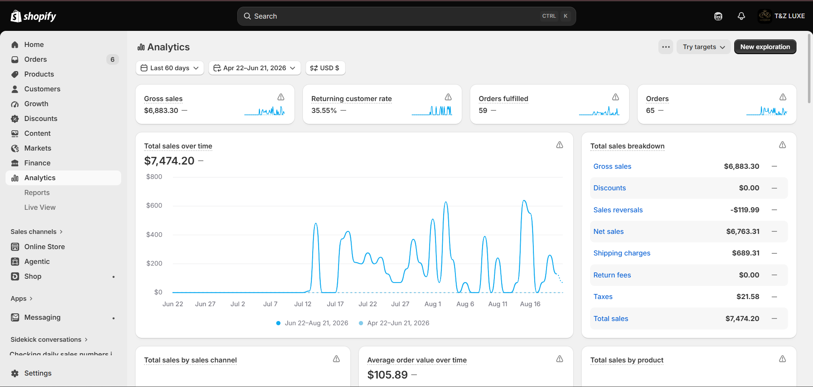

# Muhammad Faizan

**Shopify Developer & UI Designer**

I’m a Shopify developer with over two years of experience building and customizing production ecommerce stores. I work primarily with Shopify Liquid, JavaScript, HTML and CSS, combining development with a UI design background to turn brand direction and approved designs into responsive, maintainable storefronts.

My work includes custom Online Store 2.0 sections, product templates, theme-editor controls, metafields, cart interactions, responsive storefront development, Shopify Markets and third-party ecommerce integrations.

## Selected Shopify Work

### HijaBrush

Developed and customized a branded Shopify storefront for a specialized covered-hair care system.

My work included custom theme sections, responsive page development, product presentation, the Chapter Finder journey, international market configuration, fixed regional pricing, shipping profiles, Klaviyo integration and customer-facing tracking functionality.

[Visit HijaBrush](https://hijabrush.com/)

### Popzumi

Designed and developed an artisan popcorn storefront from its initial UI direction through its Shopify implementation.

My work included the responsive storefront design, custom theme sections, homepage slideshow, collection and category architecture, predictive search, Shopify Collective catalog integration, product and variant presentation, subscription setup and responsive quality assurance.

The storefront is currently in pre-launch mode. Portfolio screenshots represent the implementation completed during my involvement.

[Visit Popzumi](https://popzumi.com/)

### T&Z Luxe

Built and launched a responsive Shopify jewelry storefront, including its product presentation, shopping experience and store configuration.

The store recorded **$7,474 in total sales across 65 orders during its first 60 days after launch**. This performance reflects the client’s complete business and marketing activity alongside the storefront implementation.

[Visit T&Z Luxe](https://tzluxe.myshopify.com/)

<strong>View verified 60-day Shopify analytics</strong>

 

Shopify analytics for the 60-day period ending August 21, 2026. Shared with client permission.

### Eterniq

Developed and delivered a responsive Shopify storefront for a research-products brand. The project included catalog and variant architecture, custom content sections, mobile optimization, navigation, ecommerce configuration and domain setup.

[Visit Eterniq](https://eterniq.online/)

## Shopify Capabilities

- Shopify Liquid and Online Store 2.0
- Custom sections and theme-editor settings
- HTML, CSS and JavaScript
- Responsive storefront development
- JSON templates and product templates
- Shopify metafields and metaobjects
- Product, collection and navigation architecture
- Cart drawers and AJAX storefront interactions
- Shopify Markets, regional pricing and localization
- Shipping profiles and checkout configuration
- Klaviyo forms and email automation
- Figma-to-Shopify implementation

## Selected Code Projects

### Shopify Cart Drawer

A custom AJAX cart drawer supporting dynamic quantity updates, product removal and real-time cart updates without requiring a page reload.

[View repository](https://github.com/faizanahmed125/shopify-cart-drawer)

### Shopify and Klaviyo Popup Flow

A multi-step storefront popup connected with Klaviyo for collecting customer contact and birthday information into organized lists.

[View repository](https://github.com/faizanahmed125/shopify-klaviyo-popup)

## Background

I hold a BSCS degree from NUML Islamabad and currently handle end-to-end Shopify development in an agency environment, including storefront implementation, technical configuration, responsive QA and direct collaboration around client requirements.

## Contact

- [LinkedIn](https://www.linkedin.com/in/mfaizan125/)
- shafahd125@gmail.com
